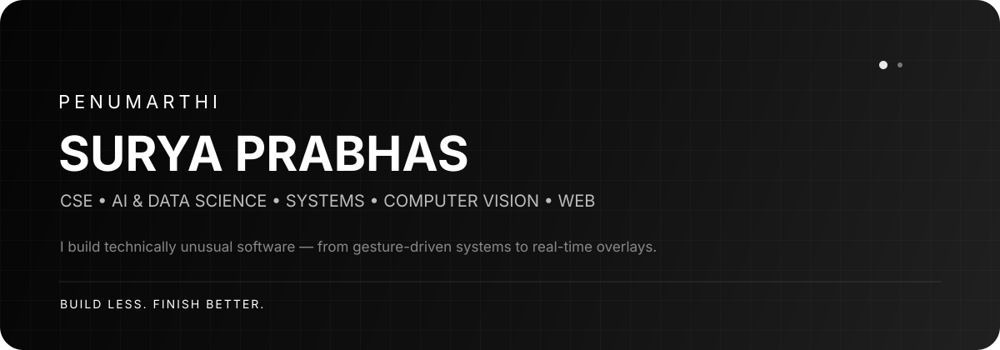

  
  
  

## Hey, I'm Surya Prabhas

I'm a **3rd-year B.Tech CSE student specializing in AI & Data Science at SCSVMV**. I enjoy building software that blends practical engineering with thoughtful user experience — from computer-vision experiments and Windows utilities to interactive web apps and AI-powered tools.

I care about **shipping projects that work, explaining how they work, and polishing the details that make them dependable**. Currently strengthening my software engineering fundamentals while building and improving real projects.

- **I build:** desktop tools, web apps, developer utilities, and AI/vision prototypes
- **I work with:** Python, C++, Java, SQL, Git, and GitHub — plus JavaScript/TypeScript and project-specific stacks
- **My mindset:** learn by building, test the edge cases, document the trade-offs
- **Find me:** [Portfolio](https://suryaprabhas.in/) · [LinkedIn](https://www.linkedin.com/in/suryaprabhaz) · [Projects](https://github.com/suryaprabhaz?tab=repositories)

---

## GitHub at a glance

### Contribution activity

> Stats cards are generated by third-party services and may occasionally be unavailable, cached, or temporarily rate-limited. Language cards show language proportions in public repositories, not overall skill level.

---

## Featured projects

<table>
<tr>
<td width="50%" valign="top">

### Gesture Drop
**Computer Vision · Networking · Python**

A gesture-driven desktop-to-mobile file transfer system.

- Hand-gesture interaction
- Local Flask transport
- Input validation and automated API tests
- Security-aware network model

[Explore repository →](https://github.com/suryaprabhaz/gesture-drop)

</td>
<td width="50%" valign="top">

### SuryaHUD
**C# · .NET 8 · Win32 · Direct3D**

A lightweight Windows FPS and system overlay.

- Real-time frame monitoring
- Direct3D/Direct2D rendering
- Ping monitoring and WPF settings UI
- Automated tests and Windows CI

[Explore repository →](https://github.com/suryaprabhaz/fps-overlay)

</td>
</tr>
<tr>
<td width="50%" valign="top">

### ₹2 Smile Machine
**Three.js · GSAP · Canvas**

An interactive nostalgia experience inspired by old Indian railway-station coin machines.

- Procedural 3D machine
- Interactive ticket generation
- Procedural audio
- Mobile safeguards and reduced-motion support

[Explore repository →](https://github.com/suryaprabhaz/nostalgia-machine)

</td>
<td width="50%" valign="top">

### FlixOrbit
**JavaScript · TMDB · UI Engineering**

A responsive movie discovery experience.

- Search and discovery
- Movie details, cast, and trailers
- Streaming availability
- Watchlist and keyboard-friendly UX

[Explore repository →](https://github.com/suryaprabhaz/flixorbit)

</td>
</tr>
<tr>
<td width="50%" valign="top">

### DocuMind
**AI · Document Management**

An intelligent personal document management and assistant project.

[Explore repository →](https://github.com/suryaprabhaz/Documind)

</td>
<td width="50%" valign="top">

### More experiments

I keep exploring ideas across developer tools, interactive experiences, automation, and practical utilities.

[Browse all repositories →](https://github.com/suryaprabhaz?tab=repositories)

</td>
</tr>
</table>

---

## Tech stack

**Languages**

**Tools & engineering**

---

## How I approach engineering

| Principle | In practice |
|---|---|
| **Build for real use** | Solve a clear problem instead of adding features just for the demo. |
| **Test the failure paths** | Invalid input, network errors, missing permissions, and edge cases matter. |
| **Keep claims measurable** | Prefer working demos, tests, and reproducible results over inflated descriptions. |
| **Make it understandable** | Clear setup instructions, architecture, and trade-offs are part of the product. |
| **Finish with care** | Performance, accessibility, responsive layouts, and reduced-motion support count. |

## Currently

I'm working toward becoming a stronger software engineer by turning ideas into complete projects: **problem → design → implementation → testing → documentation → deployment**.

### Thanks for visiting

Curiosity in. Better software out.

